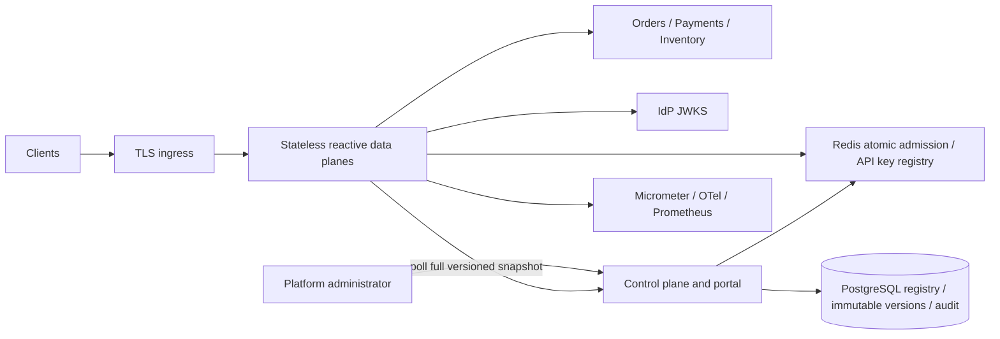
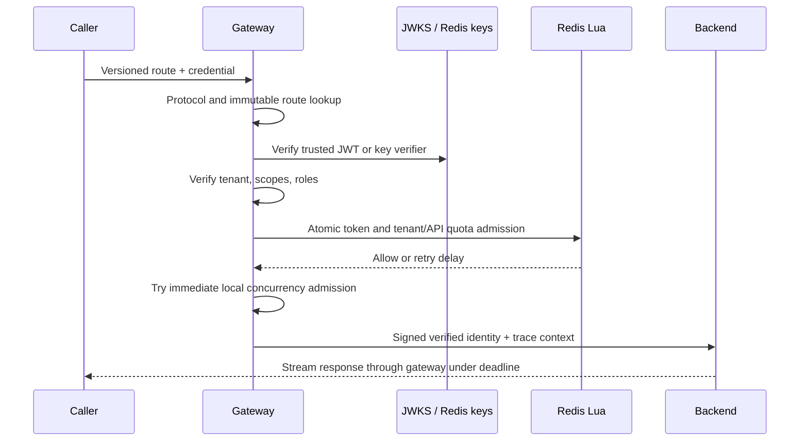
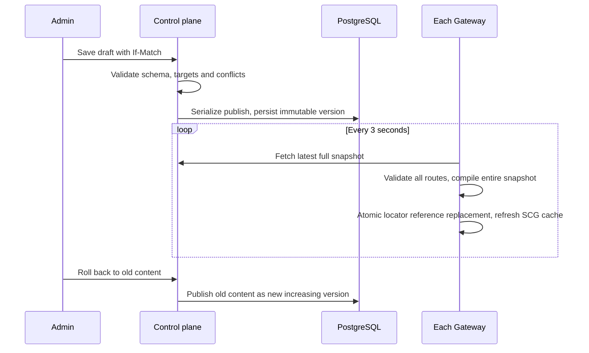
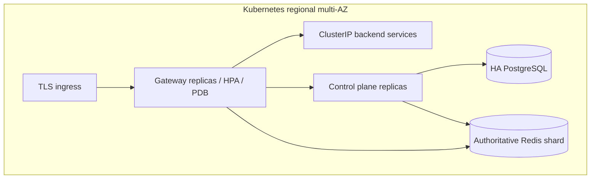

# Architecture and requirements

Target C: independent management/control and reactive request/data deployments. A static gateway is cheapest and has no
propagation lag but needs redeployment. Dynamic configuration adds change agility and eventual convergence. Control/data
separation isolates JDBC and administration, at the cost of protocol and freshness management. Multi-region adds
latency, ownership, residency and quota allocation complexity; defer until regional demand warrants it.

Security invariants: no protected upstream dispatch without verified credentials and route permission; no caller-owned
tenant or identity; no arbitrary upstream URL; no partial configuration activation; bounded admission and deadlines; no
unsafe retries; administration is a separate audience and process. Resource ownership remains a backend responsibility.

Initial SLO targets are 99.99% availability and <10ms p99 added overhead for an explicitly specified small-payload
workload. Neither is measured. Target 100k RPS initially, million RPS via measured scale-out, 100k cluster connections,
10k routes and tenants, 100k consumers. Current route lookup and conflict validation must be profiled before claiming
that scale.

The administrative connection is authenticated by a separate fixed shared secret in the local baseline; production
requires mTLS, network isolation and secret rotation. API administration tokens require `gateway-admin` audience and
`gateway.read`/`gateway.write` scopes. This implements platform-wide operators, not delegated tenant administrators.

Snapshot replacement never exposes a partially compiled list. SCG route cache refresh is asynchronous; existing
exchanges retain the prior immutable Route. Polling and refresh convergence are eventual, not a distributed atomic
cutover. Cache freshness tracks successful validated synchronization on each pod. Heartbeats expose per-pod version/age,
but do not establish a distributed atomic activation acknowledgement. Fleet convergence deadlines and alerts remain
operator responsibilities.

Kubernetes service DNS is the recommended upstream strategy: endpoint health and removal belong to Services and
readiness. Exact allowlisted service origins prevent arbitrary metadata access; enforce egress policies as defense in
depth. Random endpoint selection supports equal weight; repeated entries express coarse weight. There are no active
health probes or endpoint draining state in the gateway, or a discovery registry. Literal X-Release/X-API-Version
predicates support controlled header canaries; Kubernetes readiness/draining owns endpoint health.

Configuration hot path stays in memory. Reactive Redis/JWKS operations are asynchronous. Control plane uses blocking
JDBC only in its servlet runtime. Lua serializes admission at a tenant hash slot: correct single-primary accounting but
large tenants can create hot shards. Route-level circuit breakers keep unrelated APIs separate. Local concurrency is a
bulkhead, not a global quota.
