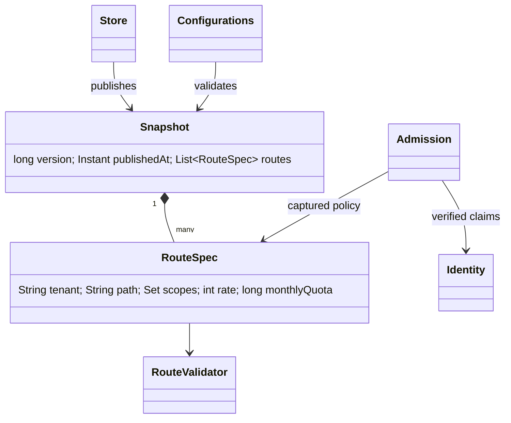
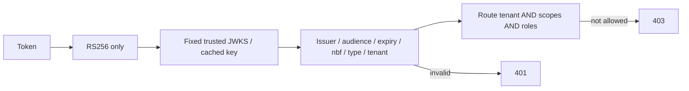
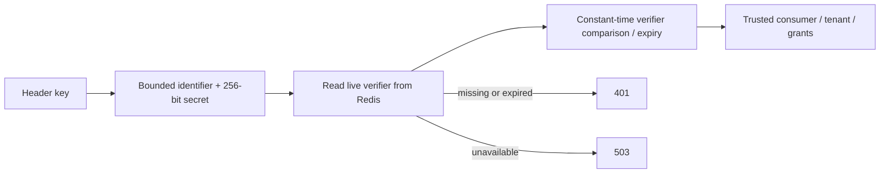
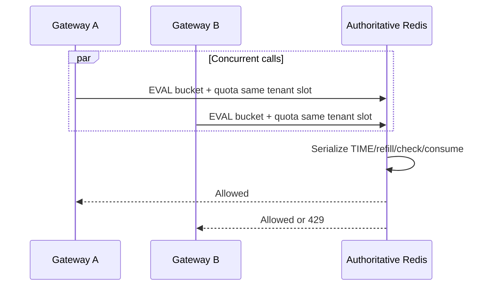
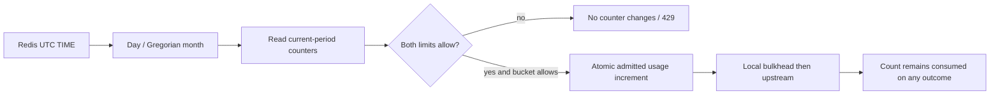
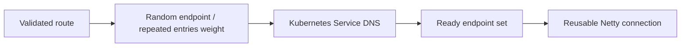
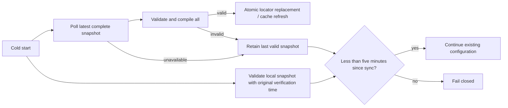
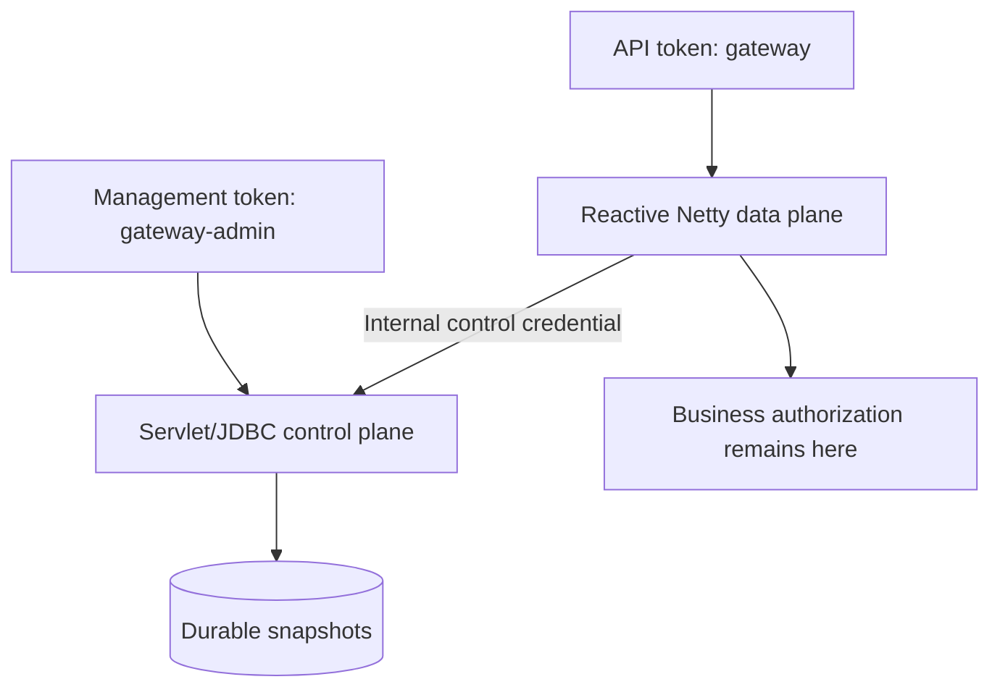

# Detailed flows

JWT validation:

API key validation:

Distributed rate limiting:

Quota enforcement:

Endpoint selection:

Circuit breaker and retry:

```mermaid
stateDiagram-v2
 CLOSED --> OPEN : transport or HTTP status failure threshold
 OPEN --> HALF_OPEN : wait duration
 HALF_OPEN --> CLOSED : successful probes
 HALF_OPEN --> OPEN : probe failure
 note right of OPEN : Per route; safe reads may retry once within deadline
```

Configuration recovery:

Control/data trust separation:

